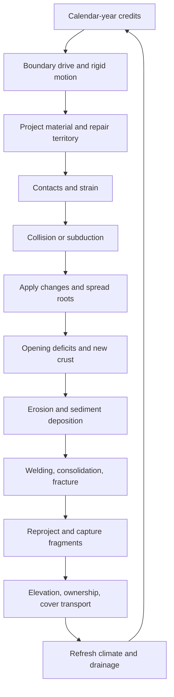

# Terra tectonics: current implementation reference

This document describes the implementation on `main` at commit `a7e0ddf`, inspected on 17 November 2026. It documents executable behaviour, including approximations and known defects. It is not a specification of a future, more physical model.

The recent requests to strengthen erosion, prevent artificial continental dilution, and add more complete volcanic land building have **not yet been implemented** in this version. The land-loss investigation is recorded separately below so those findings are not confused with existing functionality.

## Contents

1. [Scope and source map](#1-scope-and-source-map)
2. [Coordinates, units, and clocks](#2-coordinates-units-and-clocks)
3. [Initial terrain and crust](#3-initial-terrain-and-crust)
4. [Persistent and temporary state](#4-persistent-and-temporary-state)
5. [The complete geological update](#5-the-complete-geological-update)
6. [Projection, interpolation, and territory repair](#6-projection-interpolation-and-territory-repair)
7. [Boundary-driven movement](#7-boundary-driven-movement)
8. [Contacts, normals, and tensile strain](#8-contacts-normals-and-tensile-strain)
9. [Collision, subduction, arcs, and trenches](#9-collision-subduction-arcs-and-trenches)
10. [Applying changes to stored columns](#10-applying-changes-to-stored-columns)
11. [Spreading and continental stretching](#11-spreading-and-continental-stretching)
12. [Erosion, sediment transport, and consolidation](#12-erosion-sediment-transport-and-consolidation)
13. [Capture and coordinate conversion](#13-capture-and-coordinate-conversion)
14. [Welding, population control, and breakup](#14-welding-population-control-and-breakup)
15. [Elevation, land, and terrain classification](#15-elevation-land-and-terrain-classification)
16. [Climate, hydrology, and vegetation coupling](#16-climate-hydrology-and-vegetation-coupling)
17. [Boundary display and rendering](#17-boundary-display-and-rendering)
18. [Mass and area accounting](#18-mass-and-area-accounting)
19. [Controls, worker execution, and snapshots](#19-controls-worker-execution-and-snapshots)
20. [Diagnostics, tests, and measured behaviour](#20-diagnostics-tests-and-measured-behaviour)
21. [Known limitations and the land-loss diagnosis](#21-known-limitations-and-the-land-loss-diagnosis)
22. [Function index and maintenance checklist](#22-function-index-and-maintenance-checklist)

## 1. Scope and source map

Terra uses rigid plates carrying persistent columns of continental rock, basalt, and sediment. Their poses move on a rectangular world that wraps in both directions. A temporary raster projects overlapping material onto the world grid. A separate, repaired ownership raster ensures that displayed plate territories remain connected.

Boundaries generate approximate driving forces and deformation. Deformation changes column area or inventory. Buoyancy converts the resulting material distribution into terrain elevation. Annual climate and water processes respond to that terrain, and rainfall and drainage feed back into geological erosion.

This is a deliberately accelerated tectonic toy. It does not solve mantle convection, three-dimensional lithospheric deformation, magma transport, elastic stress, or spherical plate rotations. A connected territory is not the same thing as a mechanically solved plate boundary.

| Source | Responsibility |
| --- | --- |
| [PlateTectonics.kt](src/commonMain/kotlin/terra/world/PlateTectonics.kt) | Geological orchestration, motion, projection, interactions, capture, erosion, lifecycle, and publication |
| [PlateMaterial.kt](src/commonMain/kotlin/terra/world/PlateMaterial.kt) | Units, densities, material columns, plate state, sparse projected fields, transfer distribution, boundary enum |
| [PlateTopology.kt](src/commonMain/kotlin/terra/world/PlateTopology.kt) | Connected territory repair, two-source fracture growth, deterministic priority queue |
| [WorldTopology.kt](src/commonMain/kotlin/terra/world/WorldTopology.kt) | Shared periodic indices, positions, and shortest distances |
| [TerrainGenerator.kt](src/commonMain/kotlin/terra/world/TerrainGenerator.kt) | Initial terrain construction; distinct from live geology |
| [TerrainNoise.kt](src/commonMain/kotlin/terra/world/TerrainNoise.kt) | Seeded periodic fractal noise |
| [Terrain.kt](src/commonMain/kotlin/terra/world/Terrain.kt) | Terrain categories and generation settings |
| [World.kt](src/commonMain/kotlin/terra/world/World.kt) | Geography application, cover transport, biome succession, and world snapshots |
| [WorldSnapshot.kt](src/commonMain/kotlin/terra/world/WorldSnapshot.kt) | Read-only published terrain, ownership, and vegetation |
| [ClimateSimulation.kt](src/commonMain/kotlin/terra/climate/ClimateSimulation.kt) | Calendar/geological clocks and coupling order |
| [Atmosphere.kt](src/commonMain/kotlin/terra/climate/Atmosphere.kt) | Cached statistical climate and procedural displayed weather |
| [LandscapeWater.kt](src/commonMain/kotlin/terra/hydrology/LandscapeWater.kt) | Annual soil/snow/water budgets and geography refresh |
| [SurfaceWater.kt](src/commonMain/kotlin/terra/hydrology/SurfaceWater.kt), [HydrologyTopology.kt](src/commonMain/kotlin/terra/hydrology/HydrologyTopology.kt) | Drainage, lakes, catchments, and snapshots consumed by erosion |
| [GeologySettings.kt](src/commonMain/kotlin/terra/simulation/GeologySettings.kt) | Live multiplier/interval validation and geological status |
| [WorldSimulation.kt](src/commonMain/kotlin/terra/simulation/WorldSimulation.kt) | Ownership of mutable simulation and creation of presentation snapshots |
| [SimulationWorker.kt](src/jvmMain/kotlin/terra/simulation/SimulationWorker.kt) | JVM worker, playback, pause, regeneration, and publication cadence |
| [TerrainMapView.kt](src/commonMain/kotlin/terra/render/TerrainMapView.kt) | Terrain textures, relief, ownership colours, and boundary overlay |
| [SurfaceWaterRasterizer.kt](src/commonMain/kotlin/terra/render/SurfaceWaterRasterizer.kt) | River/lake raster presentation |
| [TerrainSettingsPanel.kt](src/commonMain/kotlin/terra/ui/TerrainSettingsPanel.kt), [AtlasScene.kt](src/commonMain/kotlin/terra/ui/AtlasScene.kt) | Live controls, generation drafts, and status |

There is no saved geological world format in this path. Regeneration constructs a fresh world and geological solver. Geological internals remain private/internal; public presentation exposes elevation, terrain, plate IDs, boundary types, counts, and elapsed geological time.

## 2. Coordinates, units, and clocks

### 2.1 The periodic rectangle

| Quantity | Value |
| --- | --- |
| World width | 40,000 km |
| World height | 20,000 km |
| Default raster | 283 × 212 = 59,996 tiles |
| Default tile width, `dx` | Approximately 141.343 km |
| Default tile height, `dy` | Approximately 94.340 km |
| Initial terrain reference coordinates | 283 × 212, regardless of actual raster resolution |

The geometry is a flat torus. East connects to west, north connects to south, and corners connect through both periods. Latitude-like climate and sunlight are stylized presentation layered onto that geometry.

`wrapPosition(v, period)` returns a position in `[0, period)`. `periodicDelta(v, period)` returns the shortest signed displacement in `[-period/2, period/2)`. At exactly half a period, the negative displacement is chosen. `worldIndex(x, y, width, height)` wraps both integer axes before producing a linear index.

Plate poses are wrapped world positions. Plate material indices are unwrapped local integers and may be negative or outside the world raster dimensions. They are not cropped at the poles or map edges.

### 2.2 Material units

A column's `area` is measured in units of one world tile's horizontal area. It can be fractional, larger than one, or extremely small after deformation.

`continent`, `basalt`, and `sediment` are **inventories**, not direct thicknesses. Their units are kilometres of thickness multiplied by tile-area units. A component's thickness is its inventory divided by column area.

For example, `continent = 30` and `area = 1` means 30 km of continental rock. After area shortens to `0.75` without inventory loss, the thickness is 40 km.

Internal mass is:

```text
mass = continent * 2800 + basalt * 3000 + sediment * 2400
```

This is a consistent inventory unit, not kilograms. Conversion to physical kilograms would multiply by `dx * dy * 10^9`: the inventories acquire km³ through tile area, and km³ converts to m³. Accounting comparisons within one world do not need this common factor. Raw mass totals from different resolutions are not directly comparable.

Translation uses km per effective geological year. Thus `0.00003` km/year means 3 cm/year. Spin uses radians per effective geological year. Geological radii and offsets use kilometres. Rainfall supplied to geology uses mm per calendar year as a climate intensity, then erosion integrates that intensity over effective geological years.

### 2.3 Three independent rates

1. **Calendar playback:** how quickly calendar seconds advance, selected by the speed menu.
2. **Geological acceleration:** effective geological years per calendar year.
3. **Geological update interval:** calendar years batched into one geological call.

Defaults are ×10,000 geological acceleration and a 100-calendar-year interval. A default call therefore advances 1,000,000 effective geological years.

The settings type accepts multipliers 1,000–10,000 and intervals 10–100 years. The UI steps these by 1,000 and 10 respectively. The smallest supported live step is 10,000 effective years; the largest is one million.

`PlateTectonics.advance()` itself has a reference default multiplier of 1,000. The running game passes its live multiplier explicitly. A direct test call omitting the argument can therefore run at a different geological rate from the game. The internal solver assumes compatible rain/drainage dimensions and suitable positive time inputs; it does not repeat all live-settings range validation. `ClimateSimulation.advance()` does require finite positive calendar seconds.

Changing the multiplier speeds motion, erosion, aging, cooling, consolidation, contact clocks, and lifecycle timing together. Changing the interval alters numerical step size and cost; it is not simply another independent speed multiplier.

### 2.4 Pending-year credits

`ClimateSimulation` stores one multiplier credit for each completed calendar year. Once enough credits exist for the current interval, it consumes that many and sums them. The geological call receives that sum divided by the interval as its effective multiplier.

This preserves historical rates when settings change halfway through an interval. Previously accrued years are not retroactively multiplied by the new setting. Reducing the interval can drain multiple pending batches on a subsequent annual update. Fractional calendar years do not create fractional credits.

## 3. Initial terrain and crust

### 3.1 Eight shared plate sites

`crustPlates(Random(seed xor 0x36ac71))` produces eight sites in a jittered 4 × 2 periodic grid. Each coordinate is `(gridIndex + 0.15 + random * 0.7)` times that grid cell's size in reference coordinates.

Each site has:

- A random direction angle and its unit vector `(u, v)`.
- A continental flag: 1 with probability 0.45, otherwise 0.
- A reference-space position.

Terrain generation and live crust allocation share these sites. Their number and positions do not depend on the continent-scale slider. The flag influences initial terrain; it is not a permanent plate-wide material type. A live plate can carry both oceanic and continental material.

Initial live speed is sampled from 3–9 cm/year using `Random(seed + id * 997)`. Initial spin is:

```text
(Random(seed + id * 719).nextDouble() - 0.5) * speed / 4000
```

`desiredX/Y/Spin` initially equal these values. Despite their names, they now provide persistent basal drive; there is no eight-million-year random reroll.

### 3.2 Initial terrain is a separate procedural model

`TerrainGenerator` creates the starting elevation field before persistent rock inventories exist. It is tectonic-inspired terrain construction, not a replay of previous live geological history.

The main settings defaults are:

| Setting | Default |
| --- | --- |
| Base elevation | 0.29 |
| Continent scale / octaves / strength | 85 / 4 / 0.56 |
| Regional scale / octaves / strength | 13 / 4 / 0.08 |
| Detail scale / octaves / strength | 6 / 3 / 0.02 |
| Noise persistence / lacunarity | 0.5 / 2 |
| Sea level | 0.305 |
| Mountain threshold | 0.6 |
| Mountain relief | 0.32 |
| Erosion strength | 0.45 |

At each reference-space sample:

1. Warp coordinates using two seeded noise fields, amplitude `continentScale * 0.22`, scale `continentScale * 0.65`, and two octaves.
2. Compute periodic distances to all eight sites.
3. Blend site continental flags with `exp(-(distance - nearestDistance) / 7)` weights.
4. Compute positive pairwise closing rates from the sites' relative unit vectors and their shortest separation directions.
5. Blend pairwise convergence using the site weights, multiplied by `2 / totalWeight`.
6. Sample broad, regional, detail, and ridged noise. The ridge term is `(1 - abs(noise))^4` with three octaves and scale `regionalScale * 1.8`.
7. Add seeded, bent old mountain belts associated with continental sites. Their half-lengths are `continentScale * (0.35 + 0.25 * random)`, breadths 2.5–5.5 reference units, and bends approximately ±11 units. A smooth taper fades their ends.
8. Combine convergence uplift and old ranges with noise and clamp generated elevation to `[0, 1]`.

The principal combination is:

```text
uplift = mountainRelief * (continentStrength / 0.56) * (
    min(convergence, 1.8) * (0.65 + 0.35 * continental) * (0.4 + 0.6 * ridge)
    + continental² * oldRange * (0.65 + 0.35 * ridge)
)
roughness = 0.35 + 0.65 * clamp(uplift / 0.2, 0, 1)
elevation = baseElevation
    + continentStrength * (0.52 * (continental - 0.5) + 0.18 * broad)
    + uplift
    + regional * regionalStrength * roughness
    + detail * detailStrength * roughness
```

Seeded noise uses normalized simplex fractal octaves. Amplitude is multiplied by persistence, scale divided by lacunarity, and seed advanced by 997 per octave. Simplex uses the conventional skew/unskew constants approximately 0.3660254 and 0.2113249, eight gradient choices, fourth-power corner attenuation, and a factor of 70 before clamping to `[-1, 1]`. Integer lattice hashing supplies deterministic gradients.

`TerrainNoise.periodic()` blends four translated evaluations using the quintic blend `6t^5 - 15t^4 + 10t^3` in both axes. This makes the field and its low-order derivatives meet smoothly at both seams. This is a periodic blend of planar noise, not a spherical noise evaluation.

### 3.3 Generation-time erosion

The generation slider controls both this initial filter and later geological erosion.

The initial filter first runs three conservative talus-relaxation passes. Land cells inspect their eight neighbours, subtract a distance-dependent talus allowance `0.035 * distance`, and transfer `0.1 * erosionStrength * excess` toward the largest excess drop.

A periodic hydrology topology then supplies drainage for a one-time incision filter:

```text
coefficient = erosionStrength * 0.12 * sqrt(upstreamArea) / distance
target = (oldElevation + coefficient * max(seaLevel, downstreamElevation))
         / (1 + coefficient)
newElevation = max(seaLevel, max(oldElevation - 0.10 * erosionStrength, target))
```

This second filter has a sea-level floor. It is not the same algorithm as live erosion, which transports explicit rock and sediment and does not impose this floor.

### 3.4 Converting generated heights into persistent rock

Every world tile is assigned to the nearest warped site using periodic distance. Tile area starts at 1. Geological weakness is cached from `0.5 + 0.5 * periodicNoise(seed + 8191, two octaves, scale 9)`.

Let `alt = (generatedElevation - seaLevel) * 10` km. Define water-loaded support height `airHeight = alt` on land and `alt * WATER_LOADING` underwater.

- `alt >= -1.2 km`: initialize continental rock with inventory `(airHeight + 3.7) / (1 - 2800/3300)`, and no basalt.
- Deeper water: initialize 7 km basalt and no continental rock.
- All initial columns have age 40 million effective years and no sediment.

A persistent `relief` residual makes the support equation reproduce the generated height, including bathymetry not explained by the chosen initial thicknesses. For continental columns it is essentially zero apart from rounding; oceanic columns can have substantial residual relief. It is carried and averaged with material, not independently eroded as a height field.

Local material indices use the plate reference origin and shortest world displacement. Initial projection, boundary classification, and ownership publication happen immediately. `World` initially labels all dry tiles as plains; generated mountains become a physical terrain category when geography is subsequently applied or annual cover classification runs.

## 4. Persistent and temporary state

### 4.1 `CrustCell`: persistent material

| Field | Meaning |
| --- | --- |
| `x`, `y` | Immutable integer column indices in one plate's reference lattice |
| `area` | Horizontal area in tile units |
| `continent`, `basalt`, `sediment` | Component volume inventories |
| `sedimentContinent` | Portion of sediment volume derived from continental rock |
| `age` | Area-weighted material age in effective years; not a separate age for each component |
| `relief` | Persistent support-height residual in km |
| `weakness` | Seeded, area-weighted fracture proxy carried with material |
| `support` | Recomputed buoyancy/support inventory |
| `projectionRevision`, `projectionWeight` | Cached interpolation-footprint normalization |
| `removeArea`, `compressArea` | Pending area removal and shortening |
| `dc`, `db`, `ds`, `dsc` | Pending component/provenance inventory changes |

`prepare()` recomputes support and clears pending changes. Consequently, `prepare()`/`rasterize()` must not be inserted between creating event deltas and applying them.

Cells live in a `LinkedHashMap<Long, CrustCell>`. `materialKey(x, y)` combines signed coordinate bits and mixes them with xor/shifts and the multiplier `-49064778989728563`. It is a mixed 64-bit coordinate key, not a world tile index. Insertion order also supplies stable traversal order for several operations.

### 4.2 `MaterialPlate`: a rigid frame plus deformable columns

A plate stores:

- Array-slot identity `id`, active flag, and local column map.
- Wrapped pose origin `x/y`, rotation `angle`, and cached sine/cosine.
- Fixed reference-lattice origin `referenceX/Y`.
- Actual origin velocity `vx/vy` and spin.
- Persistent basal targets `desiredX/Y/Spin`.
- Previous pose for vegetation backtracing.
- Birth/reset time, separation deadline, and separation velocity components.
- Scalar extension and local tensile tensor `stressXX/XY/YY`.
- Total material area, local bounds, world-oriented centroid offset, and mean squared radius about that centroid.
- Projection-cache pose and revision.

`prepare(width, height)` scans cells, sums area, calculates area-weighted geometric moments, prepares each column, and refreshes trigonometry. The centroid is area-weighted, not rock-mass-weighted. The squared radius is bounded below by 1 km².

IDs equal indices in the plate and raster lists. Splitting reuses the first inactive slot if possible. IDs and colours therefore do not provide permanent ancestry. Lifecycle events refer to the slots used at the event time.

### 4.3 `PlateRaster`: disposable world-space material

Each plate has projected fields for area, continental rock, basalt, sediment, sediment provenance, area-weighted weakness, support, area-weighted age, and event deltas (`remove`, `compress`, `dc/db/ds/dsc`). Age and weakness must be divided by projected area before interpreting them as averages.

`RasterIndex` maintains a dense global-to-local lookup initialized to -1, a compact list of touched world indices, and compact arrays shared by all registered fields. Capacity starts at 256 and doubles. Reading an untouched location returns zero. Writing nonzero data creates a compact entry. Clearing zeros only touched values and resets their lookup entries.

This saves storage and clearing work compared with a fully dense inventory grid for every plate. The global-to-local lookup itself remains dense per plate. Old inactive raster slots remain allocated and can be reused.

### 4.4 World-level arrays

`owner` is the connected territory map. `rawOwner` records strongest projected coverage before repair. `totalArea` sums projected coverage from all plates, including overlap. It is neither clamped to one nor identical to ownership.

`elevation`, `trench`, and vegetation backtrace `sourceX/Y` are per-world-tile arrays. `deformationEvents` records internal events during a tick; `boundaries` is independently rebuilt for publication.

### 4.5 Pairwise `Contact` memory

An unordered pair key packs the smaller ID into the upper 32 bits and the larger ID into the lower 32 bits.

Each contact stores uninterrupted contact duration, cumulative shortening, a current-step `seen` flag, an initialization flag, spreading state, subducting plate ID, proxy slab depth, total interface length, non-continental interface length, length-weighted convergence, and a reversal clock.

This is one record per touching pair, not one record per connected boundary segment. Multiple distant interfaces between the same pair share polarity and history. Transient length/convergence fields are reset during drive evaluation. Histories disappear after separation or a merger/fracture involving either endpoint.

## 5. The complete geological update

`advance(years, rain, drainage, speedMultiplier)` executes in this order:

1. Compute `dt = years * speedMultiplier` and add it to geological time.
2. Clear this tick's internal deformation labels and trench-depth field.
3. Prepare plates; evaluate driving forces from the previous projected world; move poses; age material and consolidate sediment.
4. Reproject all active plates and repair territories.
5. Observe current interfaces, mark contacts, and accumulate tensile strain.
6. Remember the current sum of deformation counters.
7. Resolve supported, closing overlaps as continental collision or subduction.
8. Distribute and apply those pending material events.
9. Redistribute excessively thick continental roots within each plate.
10. Reproject.
11. Fill eligible opening deficits using available global area budget. This function applies stretching withdrawals before adding new columns.
12. Reproject again.
13. Compute erosion and sediment redistribution; apply those changes.
14. If deformation counters increased by more than `tileCount * 0.00001`, update the meaningful-deformation timestamp.
15. Evolve contacts and lifecycle: welding, population consolidation, and fracture.
16. Reproject, then batch-capture detached/stranded material. Capture itself reprojects if it transfers anything.
17. If fewer than six plates remain, attempt another lifecycle call with zero elapsed time and reproject.
18. Rebuild the thin published boundary overlay and publish ownership/counts.
19. Derive final elevation and vegetation backtrace coordinates.
20. Apply geography to `World`.



These are large sequential operator-split updates. Force geometry can lag new material changes by a step. More rendering frames do not create intermediate physical states, and one million-year step is not numerically identical to ten 100,000-year steps.

## 6. Projection, interpolation, and territory repair

### 6.1 Frame transformations

For a column index `(ix, iy)`, local coordinates relative to the reference origin are:

```text
lx = (ix + 0.5) * dx - referenceX
ly = (iy + 0.5) * dy - referenceY
worldX = plateX + cos(angle) * lx - sin(angle) * ly
worldY = plateY + sin(angle) * lx + cos(angle) * ly
```

Inverse conversion rotates world displacement by the negative angle. World-to-material insertion uses shortest periodic displacement from the plate origin. Projection visits unwrapped world-image positions before wrapping their destination raster indices.

### 6.2 `visit()` and footprint normalization

`visit()` transforms the four corners of the plate's expanded local bounds to find an unwrapped world bounding rectangle. For each world tile centre in that rectangle, it inverse-transforms into local grid coordinates and reads up to four neighbouring columns. Bilinear weights depend on fractional local coordinates.

A rotated discrete footprint does not necessarily have weights summing to one. `prepareProjection()` therefore calculates a normalization for each column by summing its bilinear tent footprint over nearby world centres:

```text
weight = max(0, 1 - abs(localOffsetX / dx))
       * max(0, 1 - abs(localOffsetY / dy))
```

The normalization is bounded below by `1e-12`. Footprint search radii are `abs(cos)*dx + abs(sin)*dy` in world X and `abs(sin)*dx + abs(cos)*dy` in world Y. Cached weights are invalidated when the plate pose changes; newly inserted cells start with an invalid revision.

Projected inventories use `bilinearWeight / projectionWeight`. The same normalized weights return event deltas to material. This correction preserves integrated projected inventory under rotation; it does not prevent smoothing when stored material is explicitly resampled into a different frame.

### 6.3 Raw ownership

`rasterize()` clears each plate raster, prepares and projects active material, accumulates `totalArea`, and selects the strongest positive area contributor at each tile. Coverage must exceed `1e-12`. Exact equal-coverage ties retain the plate visited first, normally the lower slot ID.

That initial winner map is copied into `rawOwner`. It can contain holes, detached islands, or interleaving fragments.

### 6.4 Connected territory repair

`PlateTopology.repair()`:

1. Finds four-neighbour connected components with toroidal adjacency.
2. Keeps the largest component of each represented plate as its core, measured by tile count rather than physical/material area. The first encountered component wins equal sizes.
3. Clears all other components and uncovered tiles from ownership.
4. Grows all surviving cores simultaneously in breadth-first distance layers.
5. Resolves equal-distance claims using larger projected coverage at the contested tile, then lower stable slot ID.

Distance is grid-step/Manhattan distance, not kilometre distance. Rectangular tiles therefore make repair geometrically anisotropic. Growth always attaches a tile to an existing region, preserving connected territories. A plate that won no initial tile has no core and cannot spontaneously claim a region in this repair.

Repair changes ownership, not material. An assigned tile can initially have zero material from its assigned owner. Conversely, foreign material can remain below a coherent territory until interaction or capture handles it.

## 7. Boundary-driven movement

### 7.1 Boundary scan and initialization

`drivePlates(dt)` scans east and south interfaces once per world tile using current connected ownership. East interfaces have outward normal `(1, 0)` and length `dy`; south interfaces use `(0, 1)` and length `dx`.

At a new pair's first encountered interface:

- Nonpositive normal closing speed initializes spreading.
- Positive closing speed with at least one non-buoyant side initializes a subducting plate.
- Positive closing speed between two buoyant sides initializes neither spreading nor subduction.

The first encountered interface initializes pair-wide state. It is not an interface-averaged initialization and is not a geological reconstruction.

### 7.2 Buoyancy classification

A projected location is considered buoyant if:

```text
continent > area * 12
OR continent + basalt > area * 22
```

This is a toy deformation/subduction classification. It is not the exposed-land test. A submerged shelf can be buoyant, and thick basalt can become buoyant by the second clause.

### 7.3 Slab pull

For a remembered subducting side at a non-continental interface:

```text
age = projectedAge / max(1e-12, projectedArea)
cooling = 1 - exp(-age / 60 million years)
pull = 0.00024 * (0.35 + 0.65 * cooling)
       * min(1, slabDepth / 600 km) * interfaceLength
```

Pull is zero wherever that incoming side is buoyant. Otherwise the force points toward the opposite plate and acts on the subducting plate only. There is no equal opposing slab-pull force applied to the overriding plate; the missing reaction belongs conceptually to the unmodelled mantle.

These quantities are velocity-equivalent driving proxies, not forces calibrated in newtons. Each force contributes torque about the material-area centroid.

Proxy slab depth begins at 200 km. Actual subducted area increases it, capped at 700 km. Pull saturates at 600 km. If an entire pair interface becomes continental, depth decays exponentially over five million years. A surviving oceanic segment prevents this pair-wide decay.

### 7.4 Ridge and rift push

A contact remembered as spreading applies equal opposite outward drives:

- Both sides buoyant: `0.000035 * interfaceLength`.
- Otherwise: `0.00006 * interfaceLength`.

This drive is based on remembered spreading state, not a solved gravitational-potential gradient or magma pressure field. It can remain active while other forces temporarily oppose opening.

### 7.5 Continental resistance

If both sides are buoyant and currently converging:

```text
resistance = closingSpeed * interfaceLength * 2
```

Equal opposite forces resist convergence. Each plate also accumulates `interfaceLength * 2` into a resistance load used to slow numerical relaxation. There are no elastic rebound impulses in the current implementation.

### 7.6 Reversing an old spreading contact

For each pair, sum `closingSpeed * interfaceLength` and divide by total length. If this average exceeds `0.000005 km/year` (0.5 cm/year), accumulate a reversal clock; otherwise reset the clock to zero.

After five million years of sustained convergence, a spreading pair with some non-continental interface becomes subducting. Its incoming plate is the one with lower whole-plate continental inventory per area; an exact tie chooses the higher-ID endpoint. Its proxy slab depth is reset to 100 km.

Collision processing can also establish subduction from actual closing overlap without waiting for this drive-stage reversal condition.

### 7.7 Mobility, torque, and relaxation

For each active plate:

```text
drag = max(2000, plateArea * dx * dy / 5000)
relaxation = 1 - exp(-dt / 2 million years)
response = relaxation / (1 + resistanceLoad / drag)

translationTarget = 0.5 * persistentDesiredTranslation + boundaryForce / drag
                    + activeDaughterSeparation
```

The target centroid translation vector is capped at 12 cm/year. The spin target is:

```text
clamp(0.25 * desiredSpin + torque / (drag * max(1, radiusSquared)),
      -0.2 degrees/million years, +0.2 degrees/million years)
```

The origin-velocity target accounts for centroid offset `(cx, cy)`:

```text
originTargetX = centroidTargetX + spinTarget * cy
originTargetY = centroidTargetY - spinTarget * cx
```

Actual velocity and spin ease toward these targets using `response`. This is a damped relaxation toward a force proxy, not an exact simultaneous solve of all plate force/torque equations.

An area-weighted mean **origin translation** is subtracted from every active plate afterward. Global common drift is removed, but mean rotation is not removed. The 12 cm/year and spin limits constrain targets, not every final actual velocity after relaxation, mean removal, and origin/centroid conversion.

### 7.8 Moving poses and preventing self-overlap

Previous poses are saved for backtracing. Translation always wraps and continues. Rotation is applied only if the rotated local bounding rectangle, including a margin, fits strictly within both world periods.

`fits(plate, angle, fraction)` estimates rotated extent from `(maxIndex - minIndex + 2) * tileSpacing`. Fraction 1 is used to allow rotation; fraction 0.8 identifies oversized lifecycle bodies. A deferred rotation does not zero the stored spin, so contact velocities can still include that spin. This is an approximation worth remembering when diagnosing oversized bodies.

There is no polar reflection, north/south clamping, or periodic random heading target.

## 8. Contacts, normals, and tensile strain

### 8.1 Different normals serve different operations

The force scan and final overlay use cardinal ownership-interface normals. Collision and tensile-strain processing instead call `normal(p, q, tile)`.

That normal estimates the gradient between the two plates' projected area fields:

```text
nx = (areaP[west] - areaP[east] - areaQ[west] + areaQ[east]) / dx
ny = (areaP[north] - areaP[south] - areaQ[north] + areaQ[south]) / dy
```

If its length is below `1e-10`, the fallback is the shortest vector from plate P's pose origin to Q's pose origin. The result is normalized with a denominator floor of `1e-12`. Coincident origins and zero gradient can therefore yield a zero normal.

`closing()` includes rotational velocity at the sampled world tile centre:

```text
velocityX = vx - spin * shortestYFromOrigin
velocityY = vy + spin * shortestXFromOrigin
closing = dot(velocityP - velocityQ, normal)
```

Positive values close the boundary. Negative values open it. Forces, collision selection, strain accumulation, and published boundary colours need not use exactly the same local normal.

### 8.2 Observing contact and accumulating strain

`observeContacts()` first clears `seen` on every existing pair. It scans east/south ownership interfaces, marks their contacts seen, and measures opening even if no visible material gap exists yet.

For each interface:

```text
opening = max(0, -closingSpeed)
extensionContribution = opening * dt / min(dx, dy)
```

Both plates receive half that contribution divided by their own material area in their scalar `extension`.

The world normal is rotated into each plate's local frame. Its outer product, multiplied by the unhalved contribution, accumulates into `stressXX/XY/YY`. This tensor supplies fracture orientation; it is not an elastic stress tensor with pressure units. Scalar extension and tensor magnitude therefore do not have identical normalization.

Strain accumulates until lifecycle operations reset it. It has no relaxation or healing term between events. Ordinary welding resets scalar extension and age but does not clear the survivor's existing tensile tensor; splitting clears both scalar and tensor values on both daughters.

## 9. Collision, subduction, arcs, and trenches

### 9.1 Selecting an overlap

`collide(dt)` visits tiles with `totalArea > 1.000001`. The coherent owner is P. Among other IDs present in P's four ownership neighbours, it selects Q with greatest projected area at the same overlapping tile, requiring Q's coverage above `1e-8`.

This deliberately restricts interactions to neighbouring territories. It does not solve every possible pair in a deeply interpenetrating or multi-plate overlap. P must also have projected area above `1e-8`; repaired territory can otherwise assign P a tile with no actual P column, which previously caused zero-area division.

Nonclosing overlaps are labelled internally as transform events and receive no shortening or subduction. For a closing overlap, the proposed resolved area is:

```text
amount = min(totalArea - 1, 0.25, 2 * closingSpeed * dt / min(dx, dy))
```

The quarter-tile cap is independent of the amount of accumulated overlap. Resolution is therefore partial, especially at large timesteps. Capture can subsequently handle material that was not completely resolved geologically.

### 9.2 Continental–continental shortening

When both projected sides are buoyant at the overlapping tile:

- Divide `amount` by their relative projected areas.
- Schedule that much area compression on each side through a Gaussian patch of radius 300 km.
- Preserve rock inventories; smaller material area makes crust thicker and its support higher.
- Increase `shortenedArea` and that pair's cumulative `shortening` by the proposed amount.
- Mark an internal collision event.

There is no immediate plate identity merger. Mountain building can precede welding and can occur even when the minimum population prevents a weld. Published height arises from modified columns rather than a separately painted mountain-height increment.

### 9.3 Choosing the incoming slab

For non-continental collision, remembered subduction polarity is retained if it names P or Q and that side is not buoyant at the overlap.

Otherwise `subductingPlate()` chooses:

1. The opposite plate if one side is buoyant.
2. The older side if projected mean ages differ by more than 1,000 years.
3. The larger slot ID for a near-age tie.

The pair is marked initialized and nonspreading. Removal is capped at half the incoming projected area:

```text
removed = min(amount, incomingArea * 0.5)
fraction = removed / incomingArea
```

The pending area-removal field receives `removed`. The subduction area counter increases. Proxy slab depth increases by `removed * dx * dy / max(max(dx, dy), contactLength)` and is capped at 700 km.

### 9.4 Accretion and arc production

The incoming column fraction contains continental rock, basalt, and sediment. The following material is added to supported columns on the overriding plate:

| Material | Amount returned to overriding plate | Patch centre | Gaussian radius |
| --- | --- | --- | --- |
| Incoming continental fragments | 90% of their volume | 60 km toward overriding side | 120 km |
| Incoming sediment | 50% of its volume | 60 km toward overriding side | 120 km |
| Continental-derived sediment provenance | Same 50% fraction | Same as sediment | 120 km |
| New continental arc rock | 15% of consumed basalt mass, converted using continental density | 220 km toward overriding side | 150 km |
| New basaltic arc rock | 25% of consumed basalt mass, converted using basalt density | Same arc centre | 150 km |

These additions change inventories in existing supported columns. They do not create an eruption object, a vent, a magma reservoir, or new horizontal column area by themselves.

The removed incoming inventory is recycled through the mantle ledger. Returned continental fragments and sediment are subtracted from recycling so they are not lost from the model. New arc material is separately counted as mantle addition, equal to 40% of consumed basalt mass. Thus the ledger records a complete outgoing basalt transfer plus a separate fractional arc return, rather than silently retaining that basalt in place.

Arc production depends on consumed basalt. There are no hotspots, plume positions, persistent individual volcanoes, explicit magma fluxes, lava-flow routing, or an independent continental differentiation model in the current implementation.

### 9.5 Gaussian patch distribution

`patch()` uses a square search extending two radii from its centre. Each sampled world tile receives weight `projectedArea * exp(-0.5 * normalizedDistanceSquared)`. The weights are normalized to distribute the requested total exactly across supported projected area, up to floating-point error.

Both axes wrap at the destination indices. If the total weight is below `1e-12`, the amount is placed directly in the source tile's pending field. An unsupported fallback location may not distribute back to material; this is a numerical edge case, not an alternative rock-creation mechanism.

The kilometre radii stay fixed when resolution changes. At low resolution, a patch can affect very few tiles; at the default resolution it covers many more. Equal mass additions can therefore have very different peak-thickness effects across resolutions.

### 9.6 Trench display depth

A subduction event also creates a temporary trench centred 100 km toward the incoming side. Radius is `max(80 km, min(dx, dy) * 0.55)`. A 5 × 5 tile neighbourhood samples a Gaussian depth of up to 3 km, retaining the deepest contribution per tile.

The trench contribution is applied only where the overriding raster is not buoyant and the resulting support-derived surface is already underwater. It is an elevation offset, not a rock-removal inventory. It is cleared every geological update, so an inactive trench does not persist as stored excavated terrain.

## 10. Applying changes to stored columns

`applyEvents()` visits each active plate's interpolation footprint and calls `PlateRaster.distribute()` to transfer pending raster events back to local columns.

For normalized interpolation weight `w`, projected area `A`, and stored column area `a`, the area share is `w * a / A`.

- Removal and compression use this area share.
- Positive material additions use the same area share.
- Negative component deltas are distributed according to that column's share of the projected component inventory, rather than its share of area.

The distinction prevents subtracting continental rock from an oceanic column merely because their interpolation footprints overlap. Sediment provenance follows its own available inventory for negative withdrawals.

Each column is then updated in this order:

1. Cap removal at 95% of current area.
2. Compute the removed area fraction using denominator `max(1e-12, area)`.
3. Add that fraction of existing column mass to mantle recycling.
4. Multiply all inventories and sediment provenance by the remaining fraction.
5. Subtract removal and compression, with compression capped at 50% of the original current area; keep area at least `1e-12`.
6. Add component deltas, clamping continental rock, basalt, and sediment to nonnegative values.
7. Clamp continental sediment provenance to `[0, sediment]`.
8. If area is below `1e-7`, continental inventory below `1e-10`, and sediment below `1e-10`, recycle remaining mass and remove the cell. Basalt need not be separately below that threshold.
9. Otherwise prepare the updated column and clear its deltas.

A plate with no remaining cells becomes inactive. Caps and clamping are numerical safeguards, not an unconditional mathematical proof of conservation for arbitrary inputs or arbitrarily large steps. Tests compare actual stored mass with ledger expectations.

### Root spreading

`spreadRoots()` visits continental inventory exceeding `70 * area`, equivalent to a thickness above 70 km. It transfers excess continental rock into existing local neighbours with thickness below that level.

It searches square rings of local-grid radius 1, 2, then 3, in deterministic iteration order. No new cells are created. No basalt or sediment is moved by this operation. If neighbouring capacity is insufficient, excess remains; 70 km is not a universal clipped maximum.

The operation transfers continental inventory only; column age, weakness, and relief are not transported separately with that root flow. It conserves continental inventory but not an independently tracked physical gravitational energy. It is a local orogen-spreading proxy. Ring dimensions vary in kilometres with grid resolution and plate rotation.

## 11. Spreading and continental stretching

### 11.1 Creation budget

`fillGaps()` computes:

```text
budget = max(0, worldTileCount - sum(activePlate.materialArea))
```

New horizontal area can replace previously consumed or shortened area. An interpolation undershoot alone does not justify creating rock if stored material already covers a planet's worth of area.

The budget is recomputed from the current inventory of area; there is no separate queued magma reservoir. A deficit that cannot be used remains implicit in the global area shortage until later.

### 11.2 Eligible birth locations

Each tile checks its four ownership neighbours. For a different owner, use the cardinal shortest-step normal and measure opening. Keep the neighbour with greatest positive opening speed, requiring the neighbour's own projected coverage above 0.05.

For eligible tiles, sum `max(0, 1 - totalArea)`. The creation fraction is `min(1, budget / sumEligibleDeficits)`. Each eligible tile can then create that fraction of its deficit, ignoring areas smaller than `1e-8`.

No eligible opening means no creation even if budget remains. Newly created material belongs to the coherent owner at the birth tile. There is no alternating tile-parity ownership assignment.

### 11.3 Stretching continental rock

If both sides are buoyant and the smaller continental thickness exceeds 12 km, the birth can contain stretched continental rock:

```text
thickness = min(continentalThicknessP, continentalThicknessQ)
availableP = max(0, continentP + min(0, pendingDcP)) * 0.2
availableQ = max(0, continentQ + min(0, pendingDcQ)) * 0.2
newContinent = min(newArea * thickness * 0.8,
                   2 * min(availableP, availableQ))
```

Half is withdrawn from each side. The new area receives the withdrawn rock, making the rift material thinner without synthesizing continental mass. Positive transfer increments `riftArea` and sets an internal rift event.

If no continental rock is supplied, the new column receives `newArea * 7` basalt inventory, counted as mantle addition and `oceanCreatedArea`. This becomes an internal spreading event. A continental birth does not also receive a basalt layer in this function.

Withdrawals are applied before any births are inserted. Births are collected first, so creating one column cannot immediately fund another withdrawal in the same pass. New columns are inserted at world tile centres with zero age, sediment, and relief. Their weakness comes from the cached world-space weakness field at the birth location, then travels with the material afterward.

## 12. Erosion, sediment transport, and consolidation

### 12.1 Geological erosion surface

Live `erode()` returns immediately if generation setting `erosionStrength` is zero. Otherwise it derives surface height from projected support, applying underwater loading exactly as elevation publication does. It does not include this tick's temporary trench offset.

For each tile, use the previous hydrology snapshot's downstream link only if it is not a virtual spill link and the destination is lower on the newly computed surface. Otherwise choose the lowest of the eight wrapped neighbouring tiles. This prevents a stale drainage graph from forcing transport uphill after deformation.

Only above-sea-level tiles with a lower destination and nontrivial projected area can generate erosion. Ocean tiles can still receive sediment and terminate sediment transport.

### 12.2 Erosion rate and cap

For physical downstream distance `distance`, surface drop `drop`, and upstream land-tile count `catchment`:

```text
slope = drop / max(1 km, distance)
rateMetersPerYear = 3 * (0.00002 + 0.01 * slope * sqrt(catchment))
                    * clamp(rainMmPerYear / 1000, 0, 3)
                    * erosionStrength
removedVolume = min(drop * 0.20, rateMetersPerYear * dt / 1000) * totalArea
```

Absent drainage gives catchment 1. Catchment is a count of land tiles, not a resolution-independent km² catchment area. Rainfall is a cached annual climate intensity, not the displayed instantaneous shower field. The factor of 3 is already present in the current code; the newly requested further strengthening is not implemented.

At default strength 0.45 and rainfall 1,000 mm/year, the slope-independent term is 0.000027 m/year, or 27 m per million effective years before drop caps. The slope/catchment term can greatly increase it.

The cap is 20% of the drop to the selected lower surface, which can lie below sea level. Unlike generation-time incision, live incision has no explicit sea-level base floor. Once a source is submerged, it stops generating new erosion, but material can cross the exposed-land threshold during a step.

### 12.3 Material withdrawal and provenance

Loose sediment is removed first. Remaining requested volume removes continental rock and basalt in proportion to their available projected inventories.

Rock-to-sediment conversion preserves mass:

```text
newSedimentVolume = continentalVolume * 2800/2400
                  + basaltVolume * 3000/2400
```

Existing sediment keeps its volume. Continental-derived sediment provenance includes the corresponding share of removed loose sediment and newly eroded continental rock converted by density. Negative deltas are scheduled proportionally across the contributing plate rasters.

There is no independent height-fading term. Surface lowering comes from actual material changes and their support equation.

### 12.4 Downstream sediment movement

Sort all tiles by descending newly computed surface height. Downstream edges always descend, so the pass is acyclic even when the old hydrology links have changed.

For each nonzero sediment flux:

```text
transportSlope = (surfaceHere - surfaceDownstream) / max(dx, dy)
carriedFraction = min(0.90, 0.15 + sqrt(max(0, transportSlope) * 100))
```

Carrying is permitted only if a downstream tile exists and the current surface is above sea level. Otherwise all flux deposits there. The carried fraction, including provenance, is added to downstream flux before that lower tile is visited. The rest deposits into contributing plate rasters in proportion to projected area divided by total area.

This is a simple fraction-based transport rule, not a discharge-dependent sediment-capacity solver. It does not explicitly model deltas, coastal currents, waves, marine sediment redistribution, or separate grain sizes.

### 12.5 Lithification during movement

At the start of each geological step, every stored column ages by `dt`. Sediment consolidates with fraction `1 - exp(-dt / 20 million years)`.

Continental-derived sediment becomes continental rock using density ratio `2400/2800`; the remainder becomes basalt using `2400/3000`. Sediment and its provenance decrease by the corresponding sediment volumes. Mass is conserved, but support can change because material density and volume change.

There is no separate burial-depth, pressure, temperature, or metamorphism requirement. Newly deposited sediment normally begins consolidating on the next geological update.

## 13. Capture and coordinate conversion

### 13.1 What capture does

After deformation and lifecycle processing, connected ownership may disagree with persistent material. `captureFragments()` considers each active plate's stored column centre in world coordinates.

If the centre's assigned owner differs from the source, capture occurs when any of these is true:

- The source was the strongest raw owner there but lost that tile through connectivity repair.
- The source plate has no represented ownership core.
- None of the tile's four ownership neighbours still belongs to the source.

A column on a one-tile fringe that still touches its source can remain foreign temporarily. This prevents every tiny interpolated overlap from becoming a transfer immediately.

### 13.2 Batch semantics and conservation

All transfers are collected before any are applied. Source entries are removed first; destinations are populated second. The batch therefore does not send the same source column through multiple owners in one pass.

Transferred quantities are full column area, continental rock, basalt, sediment, sediment provenance, and area-weighted age, relief, and weakness. Captured mass is counted cumulatively for diagnostics but does not enter the mantle ledger.

Exhausted plates retire and lose their contacts. After reprojection, capture restores the connected territory map that authorized the transfer instead of immediately allowing altered interpolation weights to choose a different territory. If a restored owner has retired, that tile is cleared and topology repair runs again.

### 13.3 `addWorld()` resampling

Insertion converts a world position to the receiving plate's local frame using shortest periodic displacements and inverse rotation. It finds the four surrounding local column centres and distributes all incoming inventories and area with bilinear weights, skipping weights below `1e-12`.

Existing destination columns gain material and area. Age, relief, and weakness are updated as area-weighted averages. New cells begin empty and acquire their share. This same function serves capture, mergers, and spreading births.

The nominal world insertion point is preserved through the coordinate conversion. The receiving grid still resamples the material: individual original columns and sharp interfaces are not preserved exactly. Repeated conversions introduce numerical diffusion and can mix continental and oceanic material. Preserving scalar inventory totals does not preserve thickness distribution or every spatial moment on a periodic grid.

This is the principal suspected mechanism behind the currently measured continental dilution. Capture is an intentional local membership/velocity change outside whole-plate welding rules, but its repeated resampling is not a physical erosion process.

## 14. Welding, population control, and breakup

### 14.1 Contact history and ordinary welding

`evolvePlates(dt)` first removes contacts not seen this update or involving inactive plates, then increments surviving contact durations by `dt`.

If more than six plates are active, the first eligible contact can weld:

- At least eight million effective years of current uninterrupted contact.
- Accumulated proposed shortening at least 5% of the smaller plate's current material area.
- The projected merged local bounds fit strictly within 80% of both world periods.

Duration alone does not weld, and historical contacts between now-separated plates are discarded. The search takes the first eligible map entry, not the contact with the largest shortening. At most one ordinary weld occurs per lifecycle call.

`mergeFits()` transforms the other plate's columns into the survivor's local frame, includes a grid margin, and checks the resulting rotated bounding rectangle. It is a bounding-box safety criterion, not a mechanical assessment of whether a continental collision should weld.

### 14.2 What merging preserves and resets

`merge(a, b)` retains A's pose and reference frame. Actual velocities, spin, and persistent basal targets are area-weighted averages. B's material is transformed through world coordinates and inserted into A with `addWorld()`. B is cleared and made inactive.

The survivor's scalar extension is reset, birth/reset time becomes current geological time, and bounds/material support are prepared. Contacts involving either endpoint are removed. The survivor's tensile tensor and any still-active separation fields are not explicitly cleared by this method.

The operation records `weld` or `consolidate` and increments `mergers`. All rock inventories are intended to be conserved; numerical resampling can still alter their spatial distribution. This area-weighted motion merge is not a full angular-momentum-conserving rigid-body collision calculation.

### 14.3 Population limits and consolidation

Eight plates are generated. Lifecycle targets six to ten active plates.

At ten, breakup first attempts to make room by consolidating a touching pair. A plate is considered oceanic for this choice if its whole-plate continental inventory is less than its area, corresponding to average continental thickness below 1 km.

Pair selection minimizes:

- Smaller area if both are oceanic.
- The oceanic plate's area if only one is oceanic.
- `worldTileCount + areaA + areaB` if neither is oceanic.

This score prefers small oceanic consolidation; it is not an absolute ban on merging continental pairs. If the breakup candidate is in the chosen pair, it remains the survivor. Otherwise the larger member survives.

Consolidation bypasses ordinary weld duration, shortening, and merge-fit checks. It does not delete continental rock, but can create an oversized body. If the subsequent split is illegal, the consolidation is not rolled back. A later candidate can therefore see a changed population and material map within the same call.

Below six, fracture recovery bypasses the ordinary global spacing gate. It still requires a legal partition. The six-to-ten range is a lifecycle target with legality constraints, not a universal guarantee under every possible custom configuration. The tested worlds maintained the range.

### 14.4 Meaningful activity and fracture eligibility

A tick updates `lastDeformation` if the sum of shortening, subduction, rifting, and new-ocean area counters increases by more than `tileCount * 0.00001`. Erosion, capture, root spreading, and welding alone do not reset that activity clock.

The configuration is considered idle when at least 12 million years have passed since the later of meaningful deformation or a successful breakup. An idle world prioritizes a legal fracture. The watchdog does not regenerate terrain, teleport continents, or choose new random global headings.

Unless population is below six, ordinary breakup attempts are spaced at least eight million years apart. A candidate must carry at least 2% of planetary area and satisfy at least one condition:

- The world is idle.
- Population is below six.
- The plate fails the 80%-period bounds test.
- It is at least 40 million years since its last creation/merge and has at least 12% accumulated extension.

Age alone is not a fracture trigger. Candidates are sorted by an oversized bonus of `1e12`, plus `extension * 1e8`, plus age. The first legal successful fracture ends the search. `lastBreakup` changes only after success; idle success also increments `watchdogBreakups`.

### 14.5 Choosing the tensile axis and seeds

If the local tensile tensor has nontrivial trace, choose its principal axis:

```text
theta = 0.5 * atan2(2 * stressXY, stressXX - stressYY)
```

Otherwise use the longer local material-bounds axis in kilometres. Rotate this axis into world space.

Sort the parent's connected territory tiles by shortest displacement along that direction. Use the parent's projected area to choose seeds near cumulative quarter and three-quarter area points. Fewer than two region tiles or coincident seeds defers the fracture.

The stored material cells are separately mapped by their world centres to territory tiles. Final material assignment uses the selected tile label, not a sorted straight cut through column indices.

### 14.6 Weakness-guided two-source growth

For each parent territory tile:

```text
weak = projectedWeakness / projectedArea
thinness = clamp((35 - projectedContinentalThickness) / 25, 0, 1)
growthCost = 1 + 3 * (0.5 * weak + 0.5 * thinness)
```

If projected area is effectively absent, use cached world weakness. A larger value means a growth front crosses the tile more slowly. Both fronts therefore tend to meet along weak/thin regions; this is why the code's cost increases with weakness rather than decreases.

The main seeded weakness scale corresponds to approximately 1,272 km in X and 849 km in Y, with a finer second octave. It is a material property after creation, not freshly regenerated noise at every fracture.

`PlateTopology.divide()` grows two rooted fronts inside the parent's four-connected periodic territory. Adjacent-step cost is:

```text
sqrt(alongTension² + 0.25 * acrossTension²)
    * average(growthCostFrom, growthCostTo)
```

Cross-tension growth is cheaper, favouring a separating boundary approximately perpendicular to tension. Weakness bends that interface. This produces jagged two-way partitions; it does not simulate crack-tip propagation, triple-junction creation, failed rift arms, or brittle branching networks.

The custom binary heap stores immutable `(tile, label, cost)` entries. Priority is lower cost, then lower daughter label, then lower tile index. Competing entries are discarded after a tile is assigned; seed tiles are protected from the opposite label. There is no decrease-key bookkeeping.

### 14.7 Balance search and legal daughters

Eight deterministic bias trials adjust the second seed's initial cost. Initial bias bounds are approximately `±4 * sqrt(regionTileCount) * max(dx, dy)`. Each trial bisects those bounds according to resulting stored material area.

A legal child must have area at least:

```text
max(1% of planet area, 20% of parent material area)
```

Both daughters must satisfy that minimum. Of legal trials, select the one closest to half of the parent's material area. If none is legal, defer the fracture.

The two territory regions are connected by construction. Persistent material can still include overlapping/fringe columns; this guarantee does not mean every local material lattice is a single perfectly nonoverlapping geological polygon.

### 14.8 Transferring material and separating daughters

The child receives the parent's pose, reference origin, actual velocity/spin, cached trigonometry, and previous pose. Selected `CrustCell` objects are moved directly between maps without resampling. Their identities, local coordinates, positions, inventories, and material properties are preserved at the split instant.

The parent and child inherit persistent basal targets. They receive opposite world-space separation components of 3 cm/year along tension, active for 20 million years. These components are also added immediately to actual velocity at fracture time. Subsequent target evolution adds them to basal/boundary drive; it does not override all other forces.

Both daughters reset age, extension, and tensile tensor. Contacts involving parent or child ID are removed. The first vacant plate slot is reused; otherwise a new plate and sparse raster are appended. A `fracture` lifecycle event and split counter are recorded.

## 15. Elevation, land, and terrain classification

### 15.1 The support equation

Densities are fixed:

| Material | Density, kg/m³ |
| --- | ---: |
| Continental rock | 2,800 |
| Basalt | 3,000 |
| Sediment | 2,400 |
| Mantle | 3,300 |
| Seawater used in loading factor | 1,025 |

For a stored column with area A and inventories C/B/S:

```text
oceanFraction = B / max(1e-12, C + B)
support = C * (1 - 2800/3300)
        + B * (1 - 3000/3300)
        + S * (1 - 2400/3300)
        + A * (relief + oceanFraction * 1.7 * exp(-age / 60 million years))
```

The age term supplies decaying thermal support to basaltic material. This is not a thermal diffusion solver. Age is shared/averaged with the column, including after captures and additions.

At a world tile, sum support and area across all active plate projections:

```text
airHeight = totalSupport / totalArea - 3.7 km
WATER_LOADING = (3300 - 1025) / 3300 ≈ 0.689394
heightKm = airHeight                         if airHeight >= 0
heightKm = airHeight / WATER_LOADING         otherwise
worldElevation = seaLevel + (heightKm + underwaterTrenchOffset) / 10
```

If total area is below `1e-10`, use air height -3 km before underwater loading. Height averaging includes all contributing plate material, not only the coherent owner. Overlapping columns are averaged through total area; they are not automatically stacked into an orogen.

### 15.2 Exposed land is an outcome, not an inventory

A world tile is land if `elevation >= seaLevel`. Sea level is the fixed generation setting; it is not solved from a global water-volume budget.

For pure continental rock with zero residual relief and no sediment, the exposure threshold is 24.42 km thickness. A 30 km column supports about 845 m above sea level. The same amount of rock spread over 1.5 times the area becomes 20 km thick and lies approximately 973 m underwater in this formula.

Thus total rock mass, continental rock volume, horizontal material area, and exposed land area are four different quantities. Conservation of the first does not guarantee preservation of the other three, especially their spatial distributions. There is no target land percentage and no special ocean/land tile quota.

### 15.3 Applying geography and transporting cover

For each final tile, the coherent owner's current inverse transform maps the tile centre into its local frame. Applying that owner's previous pose gives a source position in the old vegetation raster. `sampleField()` bilinearly samples that position with both axes wrapped.

`World.applyGeography()` moves tree/grass cover through those source coordinates on dry tiles and zeros it underwater. It stores new elevation and assigns:

- Ocean below sea level.
- Mountains above the generation mountain threshold.
- Plains when previously ocean/mountain terrain becomes ordinary land.
- Otherwise the existing land-biome category until annual succession updates it.

Both geography and biome revisions increase. Rock does not come from this vegetation sampling. After capture or a changed owner, backtracing uses the receiving frame's previous pose, which is a cover-transport approximation rather than exact material ancestry.

### 15.4 Annual terrain categories

Physical elevation is independent of forest/desert classification. Annual cover succession can produce plains, woods, steppe, desert, or tundra on land; mountain and ocean classifications retain physical precedence.

Cover uses temperature, moisture ratio, elevation-based rock limitation, tree establishment over 25 calendar years, tree loss over five, and grass response over three. Forest classification has hysteresis: entry above tree fraction 0.52, retention above 0.38. Desert thresholds similarly depend on previous category. Cold land can become tundra rather than desert.

`landBiomeSummary()` reports percentages **among land tiles only**. Its plains/woods/etc. percentages do not represent global land fraction and cannot by themselves measure the shrinking-land problem.

## 16. Climate, hydrology, and vegetation coupling

### 16.1 Annual order

For each completed calendar year, `ClimateSimulation`:

1. Adds the current geological multiplier credit.
2. Processes every complete pending geological interval.
3. After each geological call, refreshes statistical climate from new terrain, rebuilds landscape-water geography, and updates temperature used by water budgets.
4. Clears annual water-report accumulators.
5. Advances soil, snow, surface water, and evaporation for one calendar year.
6. Evolves world vegetation/biomes for one calendar year.

Geology therefore consumes the most recent cached climate and the previous water topology, then refreshes those systems afterward. Its erosion code checks old downstream links against the newly deformed surface to avoid invalid uphill transfers.

### 16.2 Where erosion rainfall comes from

`Atmosphere` is statistical climate, not fluid dynamics. Its annual climate stays cached between geological updates. Latitude is `asin(1 - 2 * (row + 0.5) / height)`. Geography refresh performs two circuits around each latitude row in each longitudinal direction to estimate ocean moisture exposure without an artificial longitude seam.

Land consumes exposure through `exp(-2/width - uphillRise/2500 m)`. A smooth latitude-dependent blend combines west/east exposure. Annual rainfall includes tropical and temperate latitude terms, seeded regional variation, and orographic uplift, clamped to 40–4,000 mm/year.

Mean temperature is `29 - 53*sin(latitude)^2 - elevationMeters*0.006 + regionalNoise*2` °C. Potential evaporation is at least 180 mm/year and otherwise `350 + 32 * max(0, temperature + 5)`. Rainfall/evaporation ratio, clamped to one, supplies a simple vegetation moisture measure.

These fields influence erosion and biome succession. Displayed drifting clouds, instantaneous showers, wind arrows, pressure, seasonal temperature, and daylight are procedural views evaluated for snapshots. They do not drive an atmospheric momentum solver or replace the annual geological rain budget.

### 16.3 Water and drainage after terrain changes

`LandscapeWater.refreshGeography()` rebuilds `SurfaceWater`, updates land masks, recalculates slope-sensitive infiltration and soil capacity, clears soil/snow where land is lost or newly appears, and passes excess soil water into surface stores on retained land.

Annual water evolution handles rainfall, snow accumulation/melt, infiltration, evaporation demand, soil drainage/runoff, and surface routing. Snow/rain fractions depend on temperature; melt is capped by available snow and uses `3.2 mm/day/°C` above freezing.

The geology interface consumes a `SurfaceWaterSnapshot`, specifically downstream tile indices, upstream land-tile counts, and virtual-spill flags. It does not consume instantaneous river discharge to compute its erosion rate, nor does it conserve or transport hydrological water as part of crust mass accounting.

Both drainage and river rendering use periodic world indices. Rebuilding water geography is a response to tectonics, not a source of tectonic rock.

## 17. Boundary display and rendering

### 17.1 Published boundaries are not deformation-event trails

`deformationEvents` records local collision, transform, subduction, rift, and spreading events during a tick. It is private diagnostic state and is cleared next tick.

`classifyBoundaries()` creates a fresh published byte array from **current ownership**. Each tile checks only its west and north interfaces. Interiors stay `NONE`. At a junction, the interface with larger absolute normal relative velocity wins; west wins exact ties because it is visited first and equal strength does not replace it.

The classification order is:

1. Transform if absolute normal speed is below `max(1e-10, 0.25 * relativeTranslationSpeed)`.
2. Collision if closing and both sides are buoyant.
3. Subduction if closing otherwise.
4. Rift if opening and both sides are buoyant.
5. Spreading otherwise.

Normal speed includes spin. The comparison relative speed in the transform threshold uses only the two origin translation vectors. Display labels are consequently kinematic classifications, not direct renderings of remembered contact regimes or proof that the labelled material event actually occurred this tick.

### 17.2 Colours and IDs

The plate layer is key `6`. Boundary colours are cream fallback `#fff1d0`, collision `#f39d76`, subduction `#cf8ad8`, spreading `#5ed4d0`, rift `#e5ca6e`, and transform `#8eafe8`.

Interiors use a seven-colour repeating palette at alpha 115; boundaries use alpha 235. With up to ten active IDs, different plates can share an interior colour. Slot reuse also changes which geological ancestry a colour represents.

`publishOwners()` replaces world ownership/boundary arrays and publishes active count. Moving count requires origin translation magnitude above `0.000005 km/year` (0.5 cm/year). Pure spinning plates are not counted as moving by that rule.

### 17.3 Presentation separation

Terrain textures are the seven active PNGs under `src/commonMain/resources/art/terrain/64x64/`. They remain required assets. The terrain tile map and most data overlays use nearest filtering; relief is smoothly filtered, and water/daylight/rain presentation uses its own filtering/fades.

Relief shading samples wrapped west/east/north/south elevation differences. Vegetation tint uses continuous cover fractions. Rivers and lakes have a separate higher-resolution raster. Neither shading nor filtering changes physical elevation or rock inventories.

Terrain category texture updates are amortized at up to 1,024 queued tiles per visual update. Overlay refreshes use round-robin scheduling, and completed rasters crossfade. Default overlay fade is 0.18 seconds, clouds/rain 0.3 seconds, and water 0.18 seconds. Fade buffers use premultiplied colour handling. These visual transitions do not interpolate committed geological time or feed changes back into physics.

The desktop targets 100 rendered frames per second. Physics is on its own worker and snapshots normally publish at 5 Hz, so 100 fps does not imply 100 geological solves or distinct world states per second.

## 18. Mass and area accounting

### 18.1 The mass ledger

The intended inventory relation is:

```text
storedRockMass = initialRockMass + mantleAddedMass - mantleRecycledMass
```

`rockMass` sums column inventories weighted by fixed component density. `mantleAddedMass` and `mantleRecycledMass` are cumulative diagnostic counters; there is no simulated finite mantle reservoir limiting additions.

| Process | Rock-mass effect | Ledger effect |
| --- | --- | --- |
| Rigid pose motion | None | None |
| Temporary raster projection | None | None |
| Territory repair | None; labels only | None |
| Continental shortening | Preserves rock, reduces area | None |
| Root spreading | Redistributes continental rock | None |
| Continental rift stretching | Redistributes continental rock into new area | None |
| Capture/merge/split | Intended to preserve full inventories | None |
| Erosion/deposition | Converts and moves rock/sediment with density conversion | None |
| Sediment consolidation | Converts provenance back into rock with density conversion | None |
| New spreading basalt | Adds `newArea * 7 * basaltDensity` | Mantle addition |
| Subduction removal | Removes incoming inventory fraction | Mantle recycling |
| Continental/sediment accretion | Returns specified removed fractions | Subtract returned mass from recycling |
| Arc rock production | Adds 40% of consumed basalt mass | Mantle addition |
| Pruning a tiny cell | Removes remaining inventory | Mantle recycling |
| Trench visual offset | No material change | None |

The counters do not constrain land area, preserve a continental crust thickness histogram, or ensure physical plausibility of material paths. A correct ledger can accompany severe geographical degradation.

### 18.2 Horizontal area is a different budget

Stored column area decreases through compression and subduction and increases through spreading births. Global shortage authorizes creation; local projected area still has overlaps and gaps. Territory repair fills ownership holes without adding material.

The sum of stored area often returns to planetary area after gap filling. That does not imply that every tile has exactly one unit of projected area, nor that every tile's assigned owner supplies its physical surface.

### 18.3 What is and is not conserved

Conservative operations intend to preserve inventories of C/B/S, with sediment provenance and weighted properties transferred appropriately. Splitting alone also preserves original column objects and positions exactly at the event instant.

The system does not promise conservation of mechanical energy, linear/angular momentum through its driving/merging rules, surface hypsometry, shoreline length, exposed land fraction, global seawater volume, or individual material ages through mixing. Continental and sediment rock can explicitly enter the mantle. Basalt can explicitly supply new arc rock.

Floating-point floors, event caps, local interpolation, topology repair, and pruning must be evaluated through tests; conservation at tested settings is not a guarantee for arbitrary resolutions or unsupported large timesteps.

## 19. Controls, worker execution, and snapshots

### 19.1 Live versus regenerated settings

Settings → Simulation changes the geological multiplier and interval live. It neither rebuilds the world nor advances a paused simulation. Defaults reset to ×10,000 and 100 years. Pending credits retain their accumulated multipliers.

Landform and advanced-generation settings are drafts requiring regeneration. Erosion strength is one of those generation settings; it is not currently a separate live geology slider. The same stored strength affects generation-time filtering and live erosion.

Regeneration replaces the mutable simulation and resets elapsed time/material/lifecycle history, but the worker's live geological settings remain selected and are reapplied to the new world.

### 19.2 Single-owner worker

One daemon JVM thread, `terra-simulation`, owns mutable world, climate, water, and geology. Atomic references receive desired world requests and controls, and publish the latest presentation snapshot. Renderer code reads snapshots rather than mutating these solvers.

The default playback starts at one calendar year per wall second. Menu choices range from realtime through 1h/s, 12h/s, day/s, month/s, year/s, 10 years/s, and Max.

At fixed speed, the work quantum is `clamp(requestedRate * 0.05, 1 second, 1 year)`. Wall time adds pending calendar time, capped at twenty quanta. Speed or pause changes clear pending playback time and restart achieved-rate measurement. They do not erase geological year credits already stored in the climate simulation.

Max uses one-calendar-year quanta and runs continuously, without a frame budget or fixed-speed backlog throttle. It still checks commands between annual calls. A long geological step cannot be interrupted halfway through its private mutation sequence.

### 19.3 Publication and failures

Normal publication occurs at most every 200 ms, with immediate publication opportunities for control/world changes. The mailbox holds the newest snapshot, so intermediate publications can be dropped by the UI without queuing every geological state.

`WorldSimulation` reuses a world snapshot until biome revision changes. World cells and vegetation are copied for publication; owner/boundary arrays are replaced by publication rather than subsequently mutated. Changed terrain tiles accumulate so skipped presentations cannot lose dirty-category updates. Surface-water rasterization is reused until its snapshot changes.

Achieved calendar rate is measured approximately once per wall second from completed simulation time. It is not the geological multiplier and not a rendering fps measurement. The status bar reports geological Myr, selected multiplier/step, and moving/total plates.

An exception records an error for the requested generation and suppresses further simulation of that failed generation. Regenerating a different generation permits recovery. Pause/fixed-speed/failure loops wait briefly on a wake object; Max's active loop does not deliberately sleep. Closing signals the daemon to stop.

### 19.4 Performance shape

The expensive work is largely grid/material traversal, not the six-to-ten-element velocity list:

- Several raster projections and connected-territory repairs per geological step.
- Projection-footprint normalization when poses move.
- All-column visits for material preparation, aging, event application, capture, and root redistribution.
- Global erosion-height sorting, approximately O(N log N).
- Fracture candidate sorting and up to eight priority-queue growth attempts per candidate.
- Hydrology rebuilds and cached climate refresh after geography changes.
- Annual climate/water/cover work between geological steps, plus snapshot copies/rasterization.

Projection visits rotated material bounding rectangles, including holes and periodic images; highly dispersed or oversized material can cost much more than its nominal territory size suggests. Sparse raster fields reduce inventory storage, not all iteration costs.

A larger update interval saves geological calls but changes numerical behaviour. A higher multiplier alone does not execute ten copies of the old fine-step model. Fewer plates do not imply a proportional performance gain. There is no current multicore partitioning inside the tectonic solver.

## 20. Diagnostics, tests, and measured behaviour

### 20.1 Internal counters and what they mean

| Diagnostic | Interpretation |
| --- | --- |
| `effectiveYears` | Solver clock incremented at call start; a failing call can advance it before completing geography publication |
| `rockMass` | Current density-weighted stored rock/sediment inventory |
| `continentalVolume` | Stored continental rock inventory only; excludes continental-derived sediment |
| `activePlateCount` | Number of active material frames |
| `relativeSpeed` | Area-weighted RMS origin translation after common translation removal, in km/effective year |
| `capturedMass` | Cumulative mass transferred by local capture; the same rock can contribute repeatedly |
| `mantleAddedMass` | Cumulative spreading-basalt and arc additions |
| `mantleRecycledMass` | Cumulative removals, less accreted returns, including tiny-cell cleanup |
| `oceanCreatedArea` | New basalt-bearing horizontal birth area |
| `subductedArea` | Proposed incoming area removed during subduction processing |
| `shortenedArea` | Proposed continental compression area |
| `riftArea` | Birth area supplied with stretched continental rock |
| `mergers` | Ordinary welds plus population consolidations |
| `splits` | Successful fractures |
| `watchdogBreakups` | Successful fractures while the activity watchdog considered the world idle |
| `lifecycleEvents` | Latest 256 `(effectiveYears, kind, firstId, secondId)` records |

Event kinds are `weld`, `consolidate`, and `fracture`. The oldest event is discarded when the buffer is full. Capture and every individual subduction/volcanic addition are not separate lifecycle events.

Area counters record resolved/proposed events, not a direct reconstruction of final net area change after every column-level cap. A positive activity counter does not prove continent assembly. RMS origin translation does not include pure spin and is not an RMS of every material point's velocity.

There is no public per-component geological budget panel, persistent trajectory history, volcano counter, or automatic land-fraction watchdog. Full diagnostics currently require tests or an internal probe.

### 20.2 Existing automated coverage

The last verified JVM suite contains 39 tests. Build commands are:

```sh
gradle compileKotlinJvm
gradle jvmTest
```

Launch with `gradle runJvm`. A sandboxed macOS Gradle failure loading `libnative-platform.dylib` can be an access problem with Gradle native/cache/lock services, as described in [AGENTS.md](AGENTS.md).

[PlateTectonicsTest.kt](src/jvmTest/kotlin/terra/world/PlateTectonicsTest.kt) covers:

- Eight initial sites across seeds and continent-scale settings.
- Both seams/corners in terrain, cover sampling, noise, and drainage.
- Periodic rotated projection and northbound edge crossing.
- Integrated inventory under rotated normalized projection.
- Large supported steps and sediment-depletion mass accounting.
- Disconnected historical contacts being unable to weld.
- Fracture preserving original material objects/positions and subsequent daughter separation.
- The eight-million-year uninterrupted-contact welding threshold.
- Watchdog fracture without material relocation at the split instant.
- Twenty-million-year sediment consolidation with density conversion.
- Collision roots and continental rifting accounting.
- Isolated ridge erosion and subduction recycling/accretion accounting.
- Deterministic weakness-sensitive jagged fractures.
- Capture conservation of all inventories and weighted material properties, without mantle exchange.
- Coherent birth ownership instead of tile-parity crust.
- No creation from unused budget without an opening interface.
- Unsupported repaired ownership not causing zero-area subduction.
- Colder incoming oceanic material strengthening convergence.
- No former eight-million-year heading reroll or age-only fracture.
- Controlled ocean closure followed by persistent continental contact and root growth.
- Repeated lifecycle activity, population, connected territories, interface-only labels, and mass conservation.

The ocean-closure fixture isolates the process by deferring ordinary fractures. It requires approach above 2,000 km, nontrivial subduction, subsequent shortening, root thickness above 35 km, and an exposed connection between the selected continents during at least 15 of the final 20 million-year steps. It is not an assertion that every default world forms a supercontinent.

[PlateTopologyTest.kt](src/jvmTest/kotlin/terra/world/PlateTopologyTest.kt) checks deterministic capture/gap ownership and weakness-guided connected cuts across a seam. [TerrainGenerationTest.kt](src/jvmTest/kotlin/terra/world/TerrainGenerationTest.kt) checks generation properties. [AtmosphereTest.kt](src/jvmTest/kotlin/terra/climate/AtmosphereTest.kt) checks annual stepping, chronological multiplier credits, default million-year updates, and bounded climate/succession behaviour. Other JVM tests cover hydrology, rendering helpers, and camera behaviour.

Several focused tectonic tests use reflection to inspect private material or call individual stages. They test invariants and controlled fixtures rather than exposing a new runtime API.

### 20.3 Long runs and movement checks already performed

At ×10,000 with a 100-calendar-year interval:

- Seeds 31742, 42, and 123 at 60 × 44 were run to 500 million effective years each.
- Default seed 31742 at 283 × 212 was run to 300 million years.
- Each checked tick maintained connected territories, six-to-ten active plates, and boundary labels confined to ownership interfaces.
- No checked 20-million-year interval became inactive under the deformation/fracture criterion.
- Worst measured relative mass error was approximately `4.59e-14`.
- The default world's minimum recorded RMS drift was about 1.89 cm/year and its final value about 4.89 cm/year.

Those runs supplied uniform 1,000 mm/year rainfall to direct geology calls. They were not all full long-duration coupled climate/water integrations. Terrain and plate overlays were inspected separately at generation, 25, 100, and 300 million years. Coherent ownership and continued activity did **not** establish preservation of continental interiors.

A separate three-seed 40-million-year motion check disabled ordinary fractures to isolate the heading/drive policy. Net displacement divided by path length improved from approximately 0.53–0.57 under the former random-target model to 0.90–0.94. This result does not imply that naturally rotating, colliding plates should always move on straight paths.

### 20.4 Throughput measurements

A paired three-run comparison alternated fresh JVM workers on the same machine, using the default world, ×10,000 geology, 100-year interval, Max playback, and seven-second measurement windows.

Median achieved calendar rate was approximately 532 years/second before the boundary-drive changes and 644 afterward, about 21% higher. Median completed geological progress in equal windows was 32 versus 36 million years. Worker checks also verified pause, live settings acknowledgement, and retention of live settings through regeneration.

These are short fresh-world measurements, including climate/water and snapshot work. They are not guaranteed sustained rates for a late-world material configuration, another machine, or every slider setting. The former report/image directories were intentionally deleted during cleanup; these figures describe completed measurements, not files that this document requires to exist.

## 21. Known limitations and the land-loss diagnosis

### 21.1 Reproduced coupled land decline

A later diagnostic used the current code, default seed 31742, 283 × 212 tiles, default terrain settings, ×10,000 geology, 100-year steps, and normal annual climate/water coupling. Individual process omissions were made only in temporary diagnostic copies, not in repository simulation code.

| Configuration | Initial land | Land at 300 Myr | Land at 500 Myr | Continental rock volume at 500 Myr, relative to initial |
| --- | ---: | ---: | ---: | ---: |
| Normal current model | 16.29% | 14.42% | 7.62% | 1.118 |
| Geological erosion omitted | 16.29% | 8.09% | 4.42% | 1.129 |
| Local capture omitted | 16.29% | 20.84% | 18.86% | 1.130 |

In the normal run, land initially rose to about 19.41% at 25 million years, then declined. This is a long-term trend in the tested full-size configuration, not a claim that every individual geological step loses land or every seed tends monotonically to zero.

The normal model produced **more continental rock** while exposing much less land. Total continental inventory shortage cannot explain that run. Removing erosion did not prevent sinking. Removing local capture greatly reduced the decline despite similar continental inventory growth.

By 500 million years, cumulative normal-run captured mass was about 2.71 times initial total rock mass. This is repeat transfer throughput, not 271% unique new rock; the same material can be captured repeatedly.

These experiments strongly implicate repeated capture/resampling and resulting thickness redistribution. Because capture also changes plate membership, velocities, and later interactions, process omission changes subsequent trajectories. The comparison does not isolate a mathematically exact percentage of land loss attributable to interpolation alone.

### 21.2 Why conserved mass can still lose continents

`addWorld()` bilinearly distributes material and area into a destination lattice and merges it with existing columns. Repeated transfers smooth sharp continental/oceanic transitions. Overlap elevation is also averaged over total projected area, and collision resolution is capped per tick. These mechanisms can spread buoyant continental inventory into thinner, submerged mixtures rather than preserve thick interiors or stack incoming rock into coherent ridges.

Arc production can increase total continental inventory while adding it diffusely. Continental-derived sediment can be transported elsewhere and later lithify. Neither action guarantees that existing continental cores retain their supporting thickness.

Capture is therefore a numerical/material-geometry issue distinct from intentional physical erosion. Turning capture off is not a complete repair: it permits persistent stranded foreign material and unresolved ownership/material disagreement.

### 21.3 Resolution and initial-condition sensitivity

Reduced uniform-rainfall runs did not reproduce the same decline: one 60 × 44 direct-geology run grew from about 16.2% to 29.4% land over 500 million years. That comparison also differs in climate/drainage coupling, so it is not an isolated measurement of resolution alone.

Several existing rules are nevertheless explicitly resolution dependent:

- Four-neighbour repair measures grid steps rather than km.
- Capture permits a one-tile fringe.
- Root flow searches three local-grid rings.
- Erosion uses upstream tile count rather than physical catchment area.
- Collision caps area per raster tile per step.
- Fixed-kilometre arc/shortening patches cover very different numbers of cells.
- Births, material transfer, and boundary classification use raster-scale approximations.

Worlds generated from the same seed at different resolutions therefore need not share the same long-term geography.

### 21.4 Simplified or missing physical processes

The current implementation has:

- Fixed seeded basal traction and velocity-equivalent ridge/slab/resistance forces.
- Rigid plate frames plus column-area deformation, not a continuous lithospheric velocity field.
- A single mean material age and mixed composition per column.
- Algebraic support and an ocean-cooling exponential.
- Pair-wide boundary memory and a scalar slab-depth proxy.
- Global area budgeting and local empirical spreading/subduction rules.
- Deliberate population consolidation and inactivity-triggered fractures.

It does not have:

- A dynamic mantle, finite magma supply, fully coupled thermal/mechanical evolution, or spherical Euler poles.
- Explicit elastic stress, fault friction, rupture propagation, slab geometry/rollback, or a physical subduction-initiation solver.
- Persistent volcanic vents, hotspots, magma reservoirs, eruption episodes, or lava-flow deposition.
- Three-armed rift generation, failed rifts, or independently simulated transform offsets.
- Conserved ocean-water-driven sea level, marine erosion/transport, coastal wave processes, or separate sediment grain populations.
- A physical guarantee of an endless supercontinent cycle or preservation of a prescribed land fraction.

### 21.5 Requested direction, not yet implemented

The current user requirements for the next geological correction are:

1. Preserve erosion and strengthen it rather than disabling it to retain land.
2. Prevent artificial dilution of continental material during capture and other coordinate transfers.
3. Build new exposed land through rock production/accumulation, including volcanism, with elevation emerging from inventory and support.
4. Keep land fraction free to evolve; do not compensate by painting land, raising heights independently of rock, or restoring a target percentage.

Existing arc additions are a starting point, but should not be mistaken for a completed volcanic-land-building model. Hotspots and focused persistent volcanic construction remain absent. No repair to capture, extra erosion multiplier, or hotspot implementation was made during the diagnostic runs or creation of this document.

### 21.6 What future verification needs to add

Mass closure and connected ownership are necessary but insufficient. A correction should also test:

- Preservation of thick continental interiors under rigid transport and repeated frame changes without physical erosion/stretching.
- Changes in crust-thickness distributions, continental provenance, hypsometry, and exposed land over long coupled runs.
- Formation and persistence of land from concentrated volcanic additions, with every addition in the mantle ledger.
- Erosion reducing old ridges through actual sediment transfer while deposition can build new land elsewhere.
- Separation of genuine physical recycling from numerical mixing or spurious area dilution.
- Behaviour at the default resolution, not only reduced test worlds.

These are verification gaps and intended follow-up checks, not already passing acceptance guarantees.

## 22. Function index and maintenance checklist

### 22.1 Geological entry points and helpers

All following functions are in `PlateTectonics.kt` unless noted otherwise.

| Function | Purpose / important dependency |
| --- | --- |
| `crustPlates` | Shared seeded eight-site generation |
| Constructor/init | Convert generated terrain into persistent inventories and initial projections |
| `advance` | Ordered geological operator split and world publication |
| `drivePlates` | Previous-raster boundary forces, contact memory, torque, and damped targets |
| Nested `force` in `drivePlates` | Accumulate a plate force and its centroid-relative torque at a sampled tile |
| `subductingPlate` | Buoyancy/age/ID polarity choice |
| `movePlates` | Prepare, drive, remove mean drift, save poses, move, age, consolidate |
| `fits` | Rotated local-bounds period/fraction safety check |
| `visit` | Unwrapped world-image traversal and local bilinear footprint lookup |
| `prepareProjection` | Per-column conservative footprint normalization cache |
| `rasterize` | Rebuild sparse fields, total area, strongest raw ownership, connected territory |
| `captureFragments` | Batch frame changes for detached or stranded material |
| `applyEvents` | Distribute projected deltas, recycle removals, compress, add inventories, prune |
| `normal` | Area-gradient collision/strain normal with centre fallback |
| `closing` | Normal relative translation plus spin at a sampled tile |
| `patch` | Area-weighted Gaussian distribution of a requested event amount |
| `collide` | Neighbour-supported overlap resolution, roots, recycling, arcs, trench offsets |
| `fillGaps` | Global shortage budget, opening eligibility, stretching withdrawals, births |
| `addWorld` | Periodic world-to-local bilinear inventory insertion and property averaging |
| `spreadRoots` | Local redistribution above the 70 km continental thickness proxy |
| `erode` | New-surface routing, rainfall/slope/catchment erosion, provenance and deposition |
| `pairKey` | Canonical unordered pair ID packing |
| `observeContacts` | Mark current interfaces and accumulate scalar/tensor opening strain |
| `evolvePlates` | Contact pruning, welding, watchdog, consolidation, and fracture attempts |
| `mergeFits` | Prospective merged bounds in survivor frame |
| `consolidate` | Population-control touching-pair selection and conservative merge |
| `merge` | Resample B into A, average drive, reset survivor age/extension/contact history |
| `split` | Tension/weakness-guided balanced connected partition and daughter separation |
| Nested `seed` in `split` | Find the tile crossing a requested cumulative projected-area fraction |
| `classifyBoundaries` | Current thin kinematic west/north boundary overlay |
| `publishOwners` | Replace public ownership/boundary arrays and plate counts |
| `event` | Bounded lifecycle event recording |
| `sampleField` | Periodic vegetation raster interpolation only |

Supporting functions/types:

- `CrustCell.prepare/mass`, `MaterialPlate.prepare`, `RasterIndex.add/clear`, `RasterField.get/set`, and `PlateRaster.add/distribute/buoyant/clear/forEachIndex` implement the material/projection contract.
- `PlateTopology.neighbors/repair/divide` and `PlateFront.add/remove` implement periodic connectivity and fracture fronts.
- `wrapIndex`, `wrapPosition`, `periodicDelta`, `worldIndex`, `longitudeKm`, and `latitudeKm` must remain consistent across movement, projection, routing, and rendering.
- `TerrainGenerator.generate/sample/erode` and `TerrainNoise.periodic/fbm/simplexNoise/simplexCorner/lattice` construct the initial terrain and inherited weakness fields.
- `World.applyGeography`, `evolveWeatherCover`, `classifyCover`, `classifyPhysicalTerrain`, `snapshot`, and `landBiomeSummary` turn geological output into the playable world view.
- `ClimateSimulation.advance` is the chronological owner of geological credits and coupling order.

### 22.2 Invariants to preserve when changing the implementation

- Keep stored material authoritative; projected rasters and ownership are different views with different guarantees.
- Do not clear prepared/event fields before pending withdrawals/additions have been distributed and applied.
- Preserve density conversion when moving rock into or out of sediment.
- Record new mantle-derived rock and actual recycled rock explicitly.
- Treat captured material as a local frame/membership transfer, not a mantle addition.
- Reconcile topology after material/topology changes and ensure inactive slots cannot own published territory.
- Preserve both-axis periodicity in physical distance, traversal, vegetation, water, and display.
- Preserve chronological pending credits when changing live update controls.
- Keep Max independent of renderer frame budgets and keep mutable physics owned by one worker.
- Check land/thickness distributions as well as mass, connectedness, and event counts.
- Distinguish model facts, diagnostic evidence, and future intentions when updating this reference.

The source code remains authoritative if this document and a later implementation diverge.
